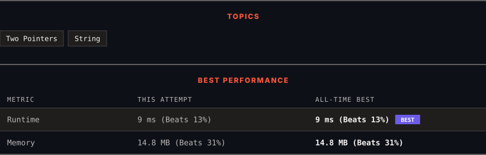

<div align="center">

# 557. Reverse Words in a String III

      

[](https://leetcode.com/problems/reverse-words-in-a-string-iii/)

</div>

---

<div align="center">

<picture>
  <source media="(prefers-color-scheme: dark)" srcset="panel-dark.svg">
  <source media="(prefers-color-scheme: light)" srcset="panel-light.svg">
  
</picture>

</div>

> **New personal best** — Runtime improved on this submission.

### HOW IT WENT

| | |
|:--|:--|
| **Attempts** | first try |
| **Time to solve** | under a minute |
| **Verdicts** | ✅ Accepted |

---

### NOTES

_No notes yet._

---

### SOLUTIONS (1)

| # | File | Language | Date |
|:-:|------|:--------:|:----:|
| 1 | [sol1.cpp](./sol1.cpp) | `C++` | 2026-11-13 ← **latest** |

---

### PROBLEM DESCRIPTION

Given a string `s`, reverse the order of characters in each word within a sentence while still preserving whitespace and initial word order.

 

**Example 1:**

```

**Input:** s = "Let's take LeetCode contest"
**Output:** "s'teL ekat edoCteeL tsetnoc"

```

**Example 2:**

```

**Input:** s = "Mr Ding"
**Output:** "rM gniD"

```

 

**Constraints:**

	- `1 <= s.length <= 5 * 10^4`

	- `s` contains printable **ASCII** characters.

	- `s` does not contain any leading or trailing spaces.

	- There is **at least one** word in `s`.

	- All the words in `s` are separated by a single space.

---

<div align="center">

<sub>Auto-synced by <strong>LeetSync</strong> · Built by <a href="https://deveshsamant.in/">Devesh Samant</a></sub>

</div>
